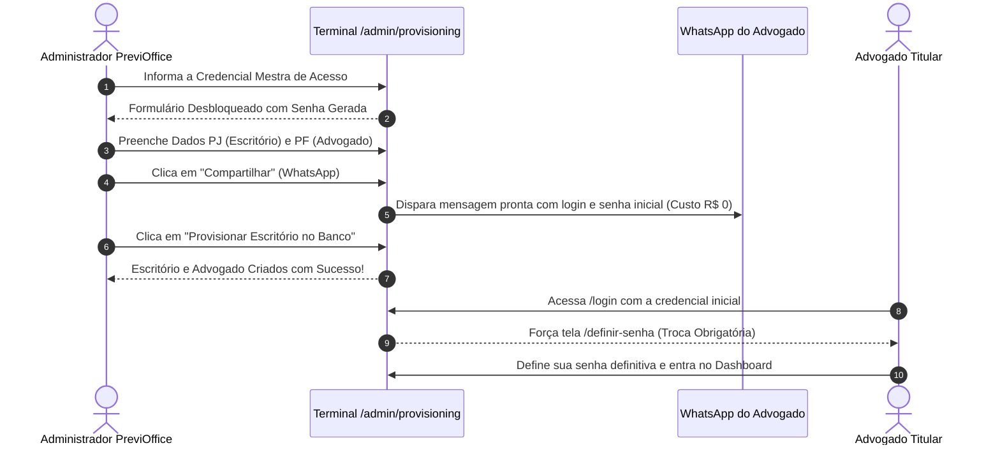

# 👤 Guia Operacional do Administrador

> [!tip] Roteiro Prático de Provisionamento
> Siga este roteiro sempre que for cadastrar um novo escritório de advocacia na plataforma e entregar o acesso ao advogado titular.

---

## 📋 Passo a Passo de Provisionamento

---

## 🛠️ Detalhamento das Etapas

### 1. Acesso ao Terminal
1. Abra o navegador e acerte a URL: [https://previoffice.vercel.app/admin/provisioning](https://previoffice.vercel.app/admin/provisioning).
2. No campo **Credencial de Acesso**, digite o segredo mestre (`MASTER_ADMIN_KEY`).
3. O painel completo de cadastro será liberado.

### 2. Dados do Escritório (Pessoa Jurídica)
- **Razão Social / Nome do Escritório**: Ex: *Silva & Oliveira Sociedade de Advogados*
- **CNPJ da Sociedade**: Formato `00.000.000/0001-00`
- **Registro OAB da Sociedade**: Ex: `1234/AM` (opcional)
- **Telefone / WhatsApp**: Telefone institucional
- **Plano**: Trial Gratuito de 90 Dias ou Anual Enterprise
- **E-mail Oficial**: E-mail institucional do escritório
- **Endereço / Sede**: Localização física

### 3. Dados do Advogado Administrador Titular (Pessoa Física)
- **Nome Completo**: Nome civil do advogado sócio
- **CPF**: Documento pessoal (formato `000.000.000-00`)
- **Inscrição OAB e UF**: Número da OAB e Estado emissor
- **Celular / WhatsApp Direto**: Número para onde será enviada a credencial
- **E-mail de Login**: E-mail que o advogado usará para entrar no sistema

### 4. Senha Inicial de Acesso e Compartilhamento
- A senha provisória já é gerada automaticamente (ex: `Prev#8mK2!w4x`) e fica **visível em destaque**.
- Se desejar outra sequência, clique no botão **"Gerar Outra"**.
- Se houver alguém ao lado, use o **ícone de olho** para ocultar a senha.
- Clique no botão **"Compartilhar"** para abrir o modal:
  - Clique em **"Enviar no WhatsApp"**: A conversa com o advogado será aberta com o texto pronto.
  - Ou clique em **"Copiar Texto Formatado"** para colar em outro mensageiro.

### 5. Finalização
- Clique em **"Provisionar Escritório no Banco de Dados"**.
- O sistema valida, cria o isolamento de tenant no banco PostgreSQL e vincula o advogado como `MANAGING_LAWYER` com a trava `must_change_password: true`.
