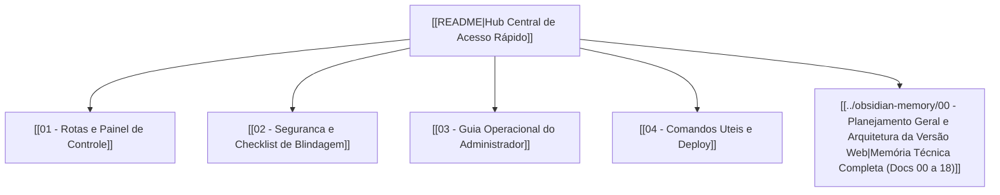

# 🚀 Hub Central de Acesso Rápido — PreviOffice

> [!tip] Painel de Navegação Imediata
> Esta pasta foi criada para oferecer **acesso instantâneo** a todas as rotas, rotinas operacionais, controles de segurança e comandos do sistema sem precisar ler longos manuais técnicos.

---

## 🧭 Mapa de Navegação Rápida

---

## 📋 Cartões de Acesso Direto

| Módulo | Finalidade Principal | Link Direto |
| :--- | :--- | :--- |
| **01. Rotas e URLs** | Lista de todas as telas, permissões e status em produção | [[01 - Rotas e Painel de Controle]] |
| **02. Segurança e Blindagem** | Resumo dos 7 escudos cibernéticos (IDOR, XSS, RLS, etc.) | [[02 - Seguranca e Checklist de Blindagem]] |
| **03. Guia Operacional** | Passo a passo para criar escritórios e enviar senhas via WhatsApp | [[03 - Guia Operacional do Administrador]] |
| **04. Comandos e Deploy** | Comandos de terminal para rodar testes, build e publicar | [[04 - Comandos Uteis e Deploy]] |
| **Memória de Engenharia** | Documentação aprofundada de decisões e arquitetura (18 notas) | [[../obsidian-memory/18 - Provisionamento Administrativo, Credenciais Temporarias e Blindagem de Seguranca\|Nota 18 (Mais Recente)]] |

---

## ⚡ Acessos Imediatos

- **URL de Produção:** [https://previoffice.vercel.app](https://previoffice.vercel.app)
- **Login do Escritório:** [https://previoffice.vercel.app/login](https://previoffice.vercel.app/login)
- **Terminal de Provisionamento:** [https://previoffice.vercel.app/admin/provisioning](https://previoffice.vercel.app/admin/provisioning)
- **Repositório GitHub:** `https://github.com/RafaelMScience/previoffice-web`
