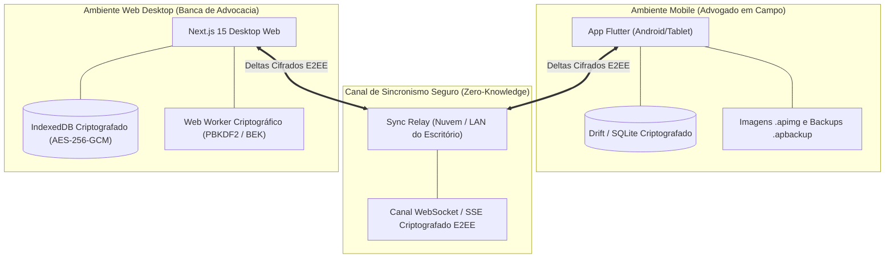

# Planejamento Geral e Arquitetura da Versão Web

> [!abstract] Visão Executiva do Projeto
> Este projeto estabelece a engenharia completa para a **Versão Web Desktop do Software de Advocacia Previdenciária** (*Alexandre Pontes Sociedade de Advogados*). O sistema Web foi concebido para operar em perfeita harmonia com o aplicativo móvel em Flutter (`e:\PIA\AlexandrePontes\app`), preservando o compromisso de **Criptografia Ponta a Ponta (E2EE)**, alta performance operacional no escritório e total conformidade com a LGPD e o sigilo profissional da OAB.

---

## 🧭 Índice do Planejamento no Cofre

O planejamento está distribuído nos seguintes documentos técnicos hipervinculados:

```mermaid
graph TD
    P0["[[00 - Planejamento Geral e Arquitetura da Versão Web]]"]
    P1["[[01 - Requisitos do Sistema, PRD e Regras de Negocio Previdenciarias]]"]
    P2["[[02 - Conexao, Protocolo de Sincronismo E2EE e Interoperabilidade Mobile]]"]
    P3["[[03 - Design System, Interface e Experiencia do Usuario (UX Desktop)]]"]
    P4["[[04 - Seguranca, Criptografia e Protecao de Dados no Navegador]]"]
    P5["[[05 - Estrategia de Testes, Validacao e Garantia de Qualidade]]"]
    P6["[[06 - Plano de Execucao, Roadmap de Sprints e Matriz de Riscos]]"]
    P7["[[07 - Conformidade Legal e Regulatória para Servidor e Nuvem]]"]
    P8["[[08 - Plano Comercial SaaS Lean MVP e Validacao de Mercado (3 Meses Gratis)]]"]
    P10["[[10 - Diretrizes de Engenharia Lean, Clean Code e Processos Operacionais]]"]
    P11["[[11 - Arquitetura de Seguranca Cibernetica, Defesa Anti-Hacker e Protecao Anti-DDoS]]"]
    P12["[[12 - Autenticacao, Login do Escritorio e Gateway Master de Provisionamento]]"]
    P13["[[13 - Entrada Rapida de Balcao (15s) e Triagem de Fila com Modal Overlay]]"]
    P14["[[14 - Mesa do Advogado, CRM de Retornos, Ficha Unica e Emissao de Contratos OAB]]"]
    P15["[[15 - Emissao de Ficha Cadastral e Relatorio em PDF (Dados do Cliente e Atendimentos)]]"]
    P16["[[16 - Integracao com Supabase, Deploy na Vercel e Blindagem de Producao]]"]

    P0 --> P1
    P0 --> P2
    P0 --> P3
    P0 --> P4
    P0 --> P5
    P0 --> P6
    P0 --> P7
    P0 --> P8
    P0 --> P10
    P0 --> P11
    P0 --> P12
    P0 --> P13
    P0 --> P14
    P0 --> P15
    P0 --> P16
```

1. **[[01 - Requisitos do Sistema, PRD e Regras de Negocio Previdenciarias]]**: Controle de Acesso Baseado em Papéis (RBAC), regras da EC 103/2019, cálculo de renda per capita (LOAS), validação com debounce de CPF e assinatura remota de procuração e contrato.
2. **[[02 - Conexao, Protocolo de Sincronismo E2EE e Interoperabilidade Mobile]]**: Protocolo bidirecional Zero-Knowledge, compatibilidade binária byte a byte com o formato `.apbackup` e fotos `.apimg`, resolução 3-Way Diff e canais LAN/Nuvem.
3. **[[03 - Design System, Interface e Experiencia do Usuario (UX Desktop)]]**: Layout de alta produtividade com Sidebar retrátil, Topbar global (`Ctrl + K`), padrão oficial de Ficha Única e acessibilidade WCAG 2.2 AA.
4. **[[04 - Seguranca, Criptografia e Protecao de Dados no Navegador]]**: Web Crypto API, PBKDF2 (120k iterações), AES-256-GCM no IndexedDB, proteção contra XSS/CSRF e decodificação de imagens direto em memória RAM (*Blob URLs* efêmeros).
5. **[[05 - Estrategia de Testes, Validacao e Garantia de Qualidade]]**: Bateria de testes com cobertura mínima de 80%, testes de interoperabilidade Dart ↔ TypeScript e fluxos E2E com Playwright.
6. **[[06 - Plano de Execucao, Roadmap de Sprints e Matriz de Riscos]]**: Cronograma de 6 Sprints (12 semanas), entregáveis por etapa, critérios de aceitação e mitigação de riscos.
7. **[[07 - Conformidade Legal e Regulatória para Servidor e Nuvem]]**: Guia de compliance integral com a LGPD (Art. 7º, 11 e 33 de transferência internacional), Marco Civil da Internet (Art. 15 - guarda de logs por 6 meses), Estatuto da OAB (inviolabilidade do escritório e sigilo profissional) e checklist técnico de servidor.
8. **[[08 - Plano Comercial SaaS Lean MVP e Validacao de Mercado (3 Meses Gratis)]]**: Modelo de negócios SaaS B2B para advogados, arquitetura de custo R$ 0,00/mês (Vercel + Supabase + Cloudflare R2), CRM de atendimento, contador de frequência de visitas e estratégia do Beta de 90 dias gratuitos.
9. **[[10 - Diretrizes de Engenharia Lean, Clean Code e Processos Operacionais]]**: Regras anti-overengineering (KISS e YAGNI), estrutura de pastas em camadas mínimas essenciais, padrões de Clean Code e mapeamento dos 5 processos de ponta a ponta do escritório.
10. **[[11 - Arquitetura de Seguranca Cibernetica, Defesa Anti-Hacker e Protecao Anti-DDoS]]**: Defesa em profundidade OWASP 2026, mitigação de DDoS L3/L4/L7 na Cloudflare, WAF, proteção de Server Actions, RLS universal no PostgreSQL e cifra de coluna para senhas do Meu INSS.
11. **[[12 - Autenticacao, Login do Escritorio e Gateway Master de Provisionamento]]**: Acesso restrito ao escritório (`/login`), rota isolada de provisionamento master (`/admin/provisioning`), comparação em tempo constante (`timingSafeEqual`), rate limiting por IP, motor i18n bilíngue (PT/EN) e container Docker standalone.
12. **[[13 - Entrada Rapida de Balcao (15s) e Triagem de Fila com Modal Overlay]]**: Check-in ágil de clientes em 15 segundos diretamente por cima da fila de atendimento no dashboard, sem perda de foco visual, reatividade em tempo real e transição progressiva para a qualificação completa.
13. **[[14 - Mesa do Advogado, CRM de Retornos, Ficha Unica e Emissao de Contratos OAB]]**: Tela de atendimento do advogado (`/clientes/[id]`), histórico cronológico de visitas, contador de frequência, registro de retornos em modal, cofre digital de documentos com upload drag-and-drop, diagnóstico de aposentadorias, emissão vetorial de Procuração, Contrato OAB e Capa de Pasta A4, e painel de andamentos processuais com fluxo direto de entrada no INSS pós-contrato fechado e disparo no WhatsApp.
14. **[[15 - Emissao de Ficha Cadastral e Relatorio em PDF (Dados do Cliente e Atendimentos)]]**: Relatório executivo do cliente com dados pessoais, documentos, endereço, contatos, dados socioeconômicos, informações previdenciárias, observações, histórico de atendimentos e bloco de assinaturas (com omissão da senha do Meu INSS por sigilo OAB/LGPD).
15. **[[16 - Integracao com Supabase, Deploy na Vercel e Blindagem de Producao]]**: Conexão com banco PostgreSQL 17 real sem mock, RLS com subquery caching em schema privado (`private.current_tenant_id()`), buckets de Storage (`client-photos` e `client-documents`), Supabase Auth com middleware de sessão `@supabase/ssr`, deploy contínuo em produção na Vercel (`previoffice.vercel.app`) e blindagem anti-reconhecimento eliminando menções a tecnologias (JWT, TLS) e termos sensíveis.

---

## ⚖️ Decisão de Arquitetura: Next.js 15 (React 19) vs Flutter Web

Para a versão desktop de escritório, foi realizada uma avaliação técnica rigorosa entre compilar o código Flutter existente para a Web versus construir uma aplicação dedicada em **Next.js 15 + TypeScript**:

| Critério de Avaliação | Next.js 15 + React 19 + TypeScript (Escolhido) | Flutter Web (Descartado para Desktop) |
| :--- | :--- | :--- |
| **Tempo de Carregamento Inicial (LCP)** | **< 0.8s** (SSR enxuto e hidratação instantânea) | **4.5s a 9s** (Download obrigatório de 2MB a 5MB do CanvasKit/WASM) |
| **Acessibilidade (WCAG 2.2 AA)** | **Nativa** (DOM semântico padrão para leitores NVDA/JAWS) | **Deficiente** (Canvas desenhado pixel a pixel sem árvore semântica pura) |
| **Produtividade em Desktop** | **Máxima** (Tabelas densas com TanStack Table, atalhos de teclado) | **Média** (Comportamento de toque mobile simulado em telas desktop) |
| **Geração e Impressão de PDFs** | **Perfeita** (CSS Print vetorial nativo e renderizadores ágeis) | **Limitada** (Rasterização de canvas com perda de nitidez em impressões) |
| **Web Workers e Criptografia** | **Nativo Imediato** (`window.crypto.subtle` sem travar a UI) | **Complexo** (Necessita ponte Dart-JS para chamar a Web Crypto API) |

> [!important] Diretriz Arquitetural
> O frontend Web desktop será implementado em **Next.js 15 (App Router)** com **TypeScript estrito**, **Tailwind CSS** e componentes **shadcn/ui**, compartilhando o mesmo contrato de dados, regras de negócio e algoritmo criptográfico implementados no app Flutter.

---

## 🏛️ Topologia do Ecossistema Mobile + Web

---

## 🔗 Relação com as Notas Existentes
- [[../Arquitetura, Processo e Desenvolvimento do Software de Advocacia|Arquitetura Geral do Software de Advocacia]]
- [[../Design System, Camadas e Templates do Aplicativo|Design System e Camadas do Mobile]]
- [[../Identidade Visual e Branding do Aplicativo|Manual de Identidade Visual e Cores]]
- [[../Manual Operacional e Guia de Uso|Manual Operacional e Procedimentos]]
- [[../APK pronto para android|Status do APK Android Compilado]]
