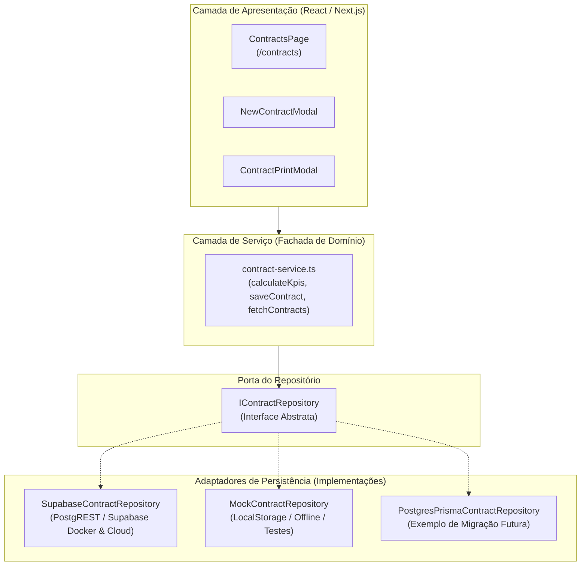

# Módulo de Contratos, Upload de Minutas PDF e Arquitetura Agnóstica de Banco

> [!abstract] Resumo Executivo
> Este documento registra a engenharia e a arquitetura completa do **Módulo de Contratos de Honorários e Procurações OAB** da versão web do PreviOffice. Detalha a implementação da substituição de minutas geradas por documentos PDF próprios e customizados do advogado, a resolução de problemas críticos de ciclo de vida e capacidade do navegador, a criação da camada desacoplada de dados baseada em **Repository Pattern / Arquitetura Hexagonal**, e o roteiro prático para auditoria no Supabase local (Docker) e migração para produção ou outros motores de banco de dados.

---

## 🧭 Índice do Documento
- [[#1. Visão Geral e Necessidades do Escritório]]
- [[#2. Arquitetura em Camadas (Repository Pattern)]]
- [[#3. O que foi Feito e Como foi Feito]]
  - [[#3.1 Upload de Minutas e Contratos Próprios em PDF]]
  - [[#3.2 Visualização e Impressão Inteligente com Toggle]]
  - [[#3.3 Persistência Sanitizada e Auditoria Contratual]]
- [[#4. Problemas Resolvidos]]
  - [[#4.1 Violação de React Rules of Hooks]]
  - [[#4.2 Exaustão de Quota do Navegador (LocalStorage QuotaExceededError)]]
  - [[#4.3 Validação Estrita de Segurança de Arquivos PDF]]
  - [[#4.4 Inconsistência de Colunas na Tabela de Atendimentos]]
- [[#5. Como Verificar e Auditar no Supabase Local (Docker)]]
- [[#6. Roteiro de Migração de Banco de Dados]]
- [[#Notas Relacionadas]]

---

## 1. Visão Geral e Necessidades do Escritório

O escritório de advocacia previdenciária *Alexandre Pontes Sociedade de Advogados* possui rotinas específicas de contratação:
1. **Modelos Próprios e Personalizados**: Frequentemente, o advogado já possui sua própria minuta em PDF diagramada com logotipo personalizado, paleta de cores, tipografia institucional e cláusulas particulares.
2. **Ciclo Híbrido de Assinatura**: O contrato pode ser gerado digitalmente ou ser enviado impresso/assinado manualmente pelo cliente na zona rural ou em domicílio.
3. **Independência Tecnológica**: O software não pode ficar acoplado rigidamente ao Supabase ou a um provedor específico. Se o escritório decidir migrar para um PostgreSQL tradicional on-premise, nuvem AWS/Azure ou outro ORM (como Prisma/Drizzle), os componentes visuais não devem sofrer alterações.

---

## 2. Arquitetura em Camadas (Repository Pattern)

Para atender à exigência de desacoplamento, adotamos o **Repository Pattern (Portas e Adaptadores)**:



### Componentes da Arquitetura:

1. **Domínio Puro (`src/types/contract.ts`)**:
   Define `Contract`, `ContractFeeStructure`, `PhysicalDocumentAttachment`, `ContractStatus`. Não importa nenhuma biblioteca externa.

2. **Interface Abstrata (`src/lib/repositories/contract-repository.ts`)**:
   Especifica o contrato que todo adaptador de persistência deve cumprir (`fetchContracts`, `saveContract`, `settleInstallment`, `updatePhysicalSignedStatus`).

3. **Adaptador Supabase (`src/lib/repositories/supabase-contract-repository.ts`)**:
   Conecta-se ao PostgreSQL via PostgREST, faz join relacional com `clients`, sanitiza os campos antes de gravar no formato `JSONB`, e insere trilhas de auditoria em `attendances`.

4. **Adaptador Mock / Local (`src/lib/repositories/mock-contract-repository.ts`)**:
   Opera em memória e localStorage com garantia de imutabilidade. Utilizado em testes automatizados (`npm test`) e modo de contingência offline.

5. **Fachada de Serviço (`src/lib/services/contract-service.ts`)**:
   Atua como ponto único de entrada para o Frontend, selecionando automaticamente o repositório adequado via `getContractRepository()` ou injeção de dependência via `setContractRepository()`.

---

## 3. O que foi Feito e Como foi Feito

### 3.1 Upload de Minutas e Contratos Próprios em PDF
- **Onde**: `src/components/contracts/new-contract-modal.tsx` e `upload-signed-modal.tsx`.
- **Como**:
  - Implementada zona de arrastar e soltar (drag-and-drop) e seletor de arquivos.
  - O usuário seleciona se o arquivo é **Contrato de Honorários**, **Procuração Ad Judicia** ou **Outro Documento**.
  - O advogado marca se o documento já está **Assinado** ou **Pendente de Assinatura**.
  - No caso de documento pendente, ele substitui a minuta padrão do sistema para aquele cliente específico, preservando a identidade visual customizada do advogado.

### 3.2 Visualização e Impressão Inteligente com Toggle
- **Onde**: `src/components/contracts/contract-print-modal.tsx`.
- **Como**:
  - O modal detecta automaticamente se há anexo em PDF (`customContractAttachment` ou `customPoaAttachment`).
  - Caso haja PDF vinculado, disponibiliza um botão de alternância (*toggle*):
    - **Visualizar PDF do Escritório**: Renderiza o PDF em um `<iframe src="data:application/pdf;base64,...">` seguro com controles de zoom e impressão nativa.
    - **Visualizar Minuta Padrão do Sistema**: Exibe o contrato em HTML gerado dinamicamente com as cláusulas calculadas da OAB.
  - Adicionado banner de rastreabilidade indicando quem enviou o PDF, data de substituição e status formal.
  - Implementado suporte legal para **Assinatura a Rogo e 2 Testemunhas** (Art. 595 do Código Civil) para clientes não alfabetizados ou impossibilitados de assinar.

### 3.3 Persistência Sanitizada e Auditoria Contratual
- **Onde**: `src/lib/repositories/supabase-contract-repository.ts`.
- **Como**:
  - Dados relacionais persistidos na tabela `public.contracts`.
  - Para evitar sobrecarga no banco de dados, arquivos binários pesados têm o `fileDataUrl` removido antes da serialização na coluna `JSONB`, mantendo apenas metadados (nome, tamanho, quem enviou, data, hash).
  - Toda emissão ou substituição gera automaticamente um registro na tabela `attendances`, garantindo histórico jurídico incontestável.

---

## 4. Problemas Resolvidos

### 4.1 Violação de React Rules of Hooks
> [!CAUTION] Causa do Erro
> No `NewContractModal`, havia um `if (!isOpen) return null;` posicionado antes do hook `useEffect` que sincronizava a minuta padrão selecionada. Isso causava o erro `updateHookTypesDev` do React em tempo de execução ao abrir e fechar o modal.

- **Solução**: Todos os hooks (`useState`, `useEffect`, `useMemo`) foram movidos para o topo da função, e a cláusula de guarda `if (!isOpen) return null;` foi posicionada estritamente após todas as declarações de hooks.

### 4.2 Exaustão de Quota do Navegador (LocalStorage QuotaExceededError)
> [!WARNING] Causa do Erro
> Arquivos PDF convertidos em Base64 ocupam vários megabytes. Ao salvar os contratos no `localStorage` do navegador (que possui limite padrão de 5MB), ocorria `QuotaExceededError`.

- **Solução**: No método `saveToStorage()` de `mock-contracts.ts` e no repositório Supabase, implementamos a sanitização automática: o campo `fileDataUrl` é expurgado antes de salvar no armazenamento persistente, mantendo o arquivo apenas em memória para a sessão de visualização ativa.

### 4.3 Validação Estrita de Segurança de Arquivos PDF
- **Problema**: Validações com operadores lógicos frouxos poderiam permitir upload de extensões mascaradas.
- **Solução**: Implementada validação dupla rigorosa:
  1. Extensão do arquivo deve terminar obrigatoriamente com `.pdf` (case-insensitive).
  2. MIME type deve ser estritamente `application/pdf`.
  3. Limite máximo de tamanho fixado em 15MB com feedback claro ao operador.

### 4.4 Inconsistência de Colunas na Tabela de Atendimentos
- **Problema**: O código anterior tentava gravar nas colunas `type` e `summary` da tabela `attendances`.
- **Solução**: Corrigido para as colunas reais do esquema PostgreSQL do Supabase: `attendance_type` e `objective`.

---

## 5. Como Verificar e Auditar no Supabase Local (Docker)

Com os containers Docker do projeto ativos, você pode inspecionar e auditar os dados em tempo real:

### A. Interface Gráfica (Supabase Studio)
Abra no navegador:
**[http://localhost:54323](http://localhost:54323)**
1. Acesse o menu **Table Editor**.
2. Clique na tabela **`contracts`** para inspecionar os contratos emitidos.
3. Clique na tabela **`attendances`** para verificar as trilhas de auditoria geradas.

### B. Terminal / PowerShell (Consulta Direta no Postgres)
```powershell
# 1. Listar últimos contratos persistidos
docker exec -it supabase_db_web psql -U postgres -d postgres -c "SELECT contract_number, lawyer_name, physical_signed_status, issued_at FROM contracts ORDER BY created_at DESC LIMIT 5;"

# 2. Inspecionar estrutura de honorários JSONB
docker exec -it supabase_db_web psql -U postgres -d postgres -c "SELECT contract_number, fee_structure->>'feeModel' as regime, fee_structure->>'estimatedSuccessFeeAmount' as exito FROM contracts LIMIT 3;"

# 3. Consultar trilha de auditoria na tabela attendances
docker exec -it supabase_db_web psql -U postgres -d postgres -c "SELECT attendance_type, objective, attended_at FROM attendances ORDER BY created_at DESC LIMIT 5;"
```

---

## 6. Roteiro de Migração de Banco de Dados

> [!TIP] Facilidade de Migração
> Graças ao padrão de repositório, o frontend **não conhece o Supabase**. Ele apenas conhece a interface `IContractRepository`.

### Cenário 1: Do Docker Local para o Supabase Real (Nuvem / Produção)
**Zero linhas de código alteradas**. Basta configurar as variáveis de ambiente no arquivo `.env.production` ou nas variáveis da Vercel:
```env
NEXT_PUBLIC_SUPABASE_URL=https://[SEU-PROJETO].supabase.co
NEXT_PUBLIC_SUPABASE_ANON_KEY=[SUA-CHAVE-ANON-PRODUCAO]
```
Ao inicializar, a fábrica `getContractRepository()` detectará as credenciais de produção e direcionará automaticamente todas as operações para o cluster em nuvem.

### Cenário 2: Migrar do Supabase para PostgreSQL Próprio (via Prisma, Drizzle ou pg)
Caso o escritório decida sair do Supabase no futuro:
1. Crie o arquivo `src/lib/repositories/postgres-contract-repository.ts`.
2. Implemente a interface `IContractRepository`:
   ```typescript
   export class PostgresContractRepository implements IContractRepository {
     async fetchContracts(tenantId: string): Promise<Contract[]> {
       // Consulta usando Prisma, Drizzle ou pool SQL puro
     }
     async saveContract(contract: Contract): Promise<void> { ... }
     // ... demais métodos da interface
   }
   ```
3. Na fábrica `getContractRepository()` em `src/lib/services/contract-service.ts`, alterne a instância retornada.
4. **Nenhum componente de tela, modal ou tabela precisará ser reescrito.**

---

## Notas Relacionadas
- [[00 - Planejamento Geral e Arquitetura da Versão Web]] — Estrutura e domínio do sistema
- [[16 - Integracao com Supabase, Deploy na Vercel e Blindagem de Producao]] — Configuração de infraestrutura, RLS e variáveis
