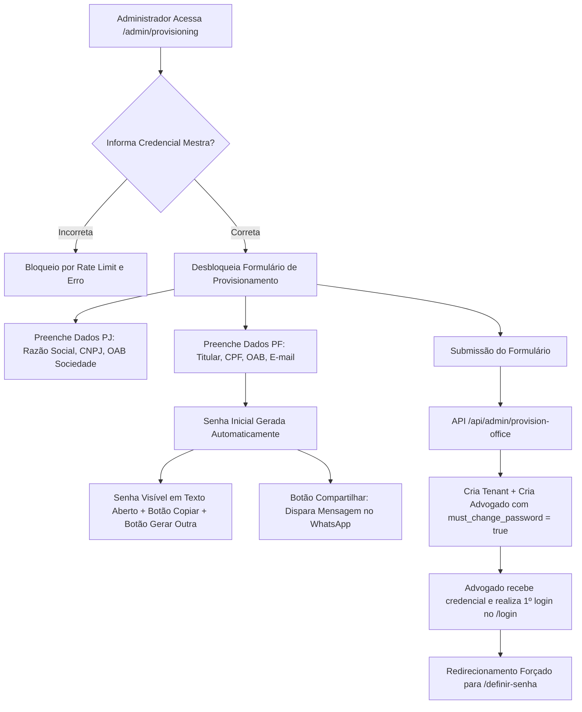

# Provisionamento Administrativo, Credenciais Temporárias e Blindagem de Segurança

> [!abstract] Resumo Executivo
> Este documento registra formalmente toda a engenharia, os procedimentos de proteção, as decisões arquiteturais e o estado atual do **Módulo de Provisionamento Administrativo de Escritórios** (`/admin/provisioning`) e do **Plano de Blindagem e Auditoria de Segurança** do PreviOffice Web. Detalha a geração automática de senhas provisórias com compartilhamento via WhatsApp a custo zero, a remoção da rota de descoberta `/admin`, e o tratamento rigoroso de 7 vetores de ataque cibernético (IDOR, XSS, Força Bruta, Escalação de Privilégios, Exposição de Chaves, Vazamento no Git e RLS no Banco de Dados).

---

## 🧭 Índice do Documento
- [[#1. O Que Foi Feito e Para Que Foi Feito]]
- [[#2. Provisionamento de Escritórios e Gestão de Senhas Iniciais]]
  - [[#2.1 Formulário Híbrido PJ e PF]]
  - [[#2.2 Geração Automática e Visibilidade de Senha]]
  - [[#2.3 Compartilhamento Rápido via WhatsApp]]
  - [[#2.4 Ciclo de Vida do Primeiro Acesso (Troca Obrigatória)]]
- [[#3. Auditoria e Blindagem dos 7 Vetores de Segurança]]
  - [[#3.1 Neutralização de IDOR em Rotas Dinâmicas]]
  - [[#3.2 Isolamento de Chaves de API e Segredos]]
  - [[#3.3 Proteção Contra Escalação Indevida de Privilégios]]
  - [[#3.4 Mitigação de Ataques de Força Bruta no Login]]
  - [[#3.5 Prevenção Contra Stored XSS em Nomes de Usuários]]
  - [[#3.6 Supressão de Credenciais e Proteção do Git]]
  - [[#3.7 Blindagem Universal com Row Level Security (RLS)]]
- [[#4. Remoção do Redirecionamento da Rota `/admin`]]
- [[#5. Validação Técnica, Testes e Produção]]
- [[#Notas Relacionadas]]

---

## 1. O Que Foi Feito e Para Que Foi Feito

Com a evolução da plataforma PreviOffice para operar como um SaaS multi-tenant robusto para escritórios de advocacia previdenciária, foi necessária a implementação de dois pilares fundamentais:

1. **Onboarding Ágil e Descomplicado de Novos Escritórios**:
   - O administrador da plataforma precisava de um meio rápido e seguro para provisionar um novo escritório (Pessoa Jurídica) e o seu respectivo Advogado Administrador Titular (Pessoa Física).
   - O envio da senha de acesso precisava ser **imediato, visível e integrável ao WhatsApp**, evitando frustrações de digitação manual de senhas ou perda de credenciais.

2. **Blindagem Contra Vulnerabilidades Críticas (OWASP Top 10)**:
   - Aplicação de defesas profundas para garantir que nenhum usuário consiga visualizar clientes de outro escritório trocando IDs na URL (IDOR).
   - Garantia de que segredos mestres (`SERVICE_ROLE`, `MASTER_ADMIN_KEY`, chaves de cifra) jamais vazem para o código executado no navegador.
   - Proteção de formulários contra injeção de scripts maliciosos (XSS) e defesa contra robôs tentando adivinhar senhas (Brute-Force).
   - Bloqueio integral das tabelas no banco de dados através de RLS (*Row Level Security*).

---

## 2. Provisionamento de Escritórios e Gestão de Senhas Iniciais

A rota `/admin/provisioning` foi desenhada como um terminal de alta segurança acessível apenas mediante autenticação com a chave mestra criptográfica (`MASTER_ADMIN_KEY`).



### 2.1 Formulário Híbrido PJ e PF
O formulário faz a cisão formal exigida pelas regras societárias da OAB:
- **Pessoa Jurídica (Sociedade de Advocacia)**: Razão Social, CNPJ, Registro de Sociedade na OAB, Telefone Principal, E-mail do Escritório, Endereço da Sede e Tipo de Plano (Trial 90 Dias ou Anual Enterprise).
- **Pessoa Física (Advogado Titular Sócio)**: Nome Completo, CPF, Número de Inscrição OAB, UF da OAB, Celular/WhatsApp direto e E-mail de Login.

### 2.2 Geração Automática e Visibilidade de Senha
- **Geração Segura**: Ao carregar a tela ou ao desbloquear o gate, a função `generateRandomPassword()` do arquivo `src/lib/auth/password-generator.ts` cria instantaneamente uma senha de 12 caracteres com letras maiúsculas, minúsculas, números e caracteres especiais (ex: `Prev#8mK2!w4x`).
- **Visibilidade por Padrão**: A senha é exibida em texto aberto com destaque visual (cor verde esmeralda em fonte monoespaçada) para que o administrador possa ler sem adivinhações.
- **Controles Interativos**:
  - **Ícone de Olho** (`Eye`/`EyeOff`): Permite ocultar em bolinhas (`••••••••`) caso haja pessoas por perto.
  - **Botão "Gerar Outra"**: Sorteia uma nova senha instantaneamente.
  - **Botão "Copiar Senha"**: Copia a sequência para a área de transferência com feedback visual imediato.

### 2.3 Compartilhamento Rápido via WhatsApp
Foi integrado um modal dedicado de compartilhamento que gera uma mensagem executiva pronta para ser enviada pelo WhatsApp com **custo R$ 0,00**:

```text
🏛️ *PreviOffice - [Nome do Escritório]*
Olá, [Dr(a). Nome]! Seu acesso ao sistema do escritório foi configurado com sucesso:

🔗 *Link de Acesso:* https://previoffice.vercel.app/login
👤 *Login:* [email@escritorio.adv.br]
🔑 *Senha Inicial de Acesso:* [Prev#8mK2!w4x]

⚠️ *Atenção:* No seu 1º acesso, o sistema exigirá a troca desta senha provisória por uma senha pessoal definitiva para garantir a segurança dos dados do escritório.
```

O botão conecta diretamente na API web do WhatsApp (`https://api.whatsapp.com/send?phone=...&text=...`), permitindo disparo com 1 toque no celular ou desktop.

### 2.4 Ciclo de Vida do Primeiro Acesso (Troca Obrigatória)
1. Durante o provisionamento no Supabase Auth, o usuário é cadastrado com a metadata `must_change_password: true`.
2. Ao efetuar o login com sucesso em `/login`, a aplicação detecta o marcador.
3. O middleware e o cliente bloqueiam a entrada no Dashboard e redirecionam compulsoriamente para `/definir-senha`.
4. Uma vez cadastrada a senha pessoal definitiva, a flag `must_change_password` é comutada para `false`, liberando o acesso irrestrito.

---

## 3. Auditoria e Blindagem dos 7 Vetores de Segurança

> [!important] Conformidade de Segurança
> As correções implementadas neutralizam os principais riscos mapeados na auditoria e alinham o sistema às diretrizes da LGPD e do sigilo advocatício da OAB.

### 3.1 Neutralização de IDOR em Rotas Dinâmicas
- **Problema**: Se um usuário de um escritório 'A' alterasse manualmente o ID na URL para `/clientes/[uuid-do-cliente-b]`, ele poderia visualizar dados confidenciais de outro escritório.
- **Solução Implementada**: No arquivo `src/app/(dashboard)/clientes/[id]/page.tsx`, foi implementada verificação no lado do servidor (SSR). O perfil do operador logado é consultado, obtendo seu `tenant_id`. A busca no Supabase exige estritamente `.eq('tenant_id', profile.tenant_id)`. Se o ID pertencer a outro tenant, o sistema dispara `notFound()`, retornando uma página 404 padronizada sem revelar sequer a existência do registro.

### 3.2 Isolamento de Chaves de API e Segredos
- **Problema**: Chaves administrativas com privilégio total de escrita e leitura de todo o banco (como a `SUPABASE_SERVICE_ROLE_KEY` e a `MASTER_ADMIN_KEY`) não podem em hipótese alguma ser empacotadas no bundle JavaScript do navegador.
- **Solução Implementada**: Auditoria minuciosa no código-fonte confirmando que apenas variáveis prefixadas com `NEXT_PUBLIC_` (como a URL pública e a `ANON_KEY`) são referenciadas no cliente. Todas as operações com `SERVICE_ROLE` e verificação de chave mestra foram isoladas em rotas de API do servidor (`/api/*`), usando módulos nativos de criptografia do Node.js (`crypto.timingSafeEqual`).

### 3.3 Proteção Contra Escalação Indevida de Privilégios
- **Problema**: Um membro de equipe cadastrado como assistente ou estagiário poderia tentar forjar requisições de API para se auto-promover a `MANAGING_LAWYER` ou alterar permissões de outros advogados.
- **Solução Implementada**: Nos endpoints `src/app/api/team/create-member/route.ts` e `src/app/api/team/update-member/route.ts`, há verificação estrita de que a requisição provém de um usuário autenticado que já possui papel de `MANAGING_LAWYER` dentro daquele mesmo `tenant_id`. Tentativas de escalação são bloqueadas com código HTTP `403 Forbidden` e registradas na tabela `audit_logs`.

### 3.4 Mitigação de Ataques de Força Bruta no Login
- **Problema**: Tentativas repetidas e automatizadas de adivinhar credenciais de login poderiam comprometer contas com senhas fracas.
- **Solução Implementada**: Na tela `src/app/(auth)/login/page.tsx`, foi implementado um mecanismo inteligente de proteção contra força bruta:
  - Rastreamento de tentativas falhas consecutivas.
  - Ao atingir 5 tentativas incorretas, o sistema aciona um **lockout temporário de 60 segundos**.
  - O botão de acesso é desativado e exibe uma contagem regressiva em tempo real: *"Acesso bloqueado temporariamente (tentativas excessivas). Aguarde 59s..."*.
  - Apenas após o término do temporizador novas tentativas são processadas.

### 3.5 Prevenção Contra Stored XSS em Nomes de Usuários
- **Problema**: Ao cadastrar advogados, membros ou clientes, a inserção de payloads como `<script>alert(1)</script>` ou `` poderia resultar em execução arbitrária de código nos navegadores dos outros operadores do escritório.
- **Solução Implementada**:
  - Criada a função de sanitização `sanitizePlainName()` em `src/lib/auth/team-utils.ts`, que remove tags HTML e caracteres de injeção (`<`, `>`, `"`, `'`, `&`).
  - Atualizada a validação `validateTeamMemberInput()` com rejeição explícita via regex de expressões como `javascript:`, `onerror=`, `onload=`, `eval(` e tags de marcação.
  - Sanitização aplicada uniformemente na rota de provisionamento master (`/api/admin/provision-office`) e nas rotas de equipe (`/api/team/create-member` e `/api/team/update-member`).

### 3.6 Supressão de Credenciais e Proteção do Git
- **Problema**: Risco de envio acidental de arquivos de ambiente com senhas reais ou tokens de produção para o repositório no GitHub.
- **Solução Implementada**:
  - O arquivo `.gitignore` foi configurado e validado para ignorar `.env`, `.env*.local`, `.env.production`, `.env.docker` e `.vercel`.
  - Executada a inspeção via `git ls-files` confirmando que nenhum arquivo `.env` real está sob controle de versão. O único arquivo mantido é o `.env.example`, preenchido exclusivamente com marcadores de posição ilustrativos (*placeholders*).

### 3.7 Blindagem Universal com Row Level Security (RLS)
- **Problema**: Se o Supabase for acessado com a chave pública anônima (`ANON_KEY`) e o RLS estiver desativado em alguma tabela, qualquer pessoa na internet poderia ler ou alterar o banco de dados inteiro.
- **Solução Implementada**:
  - Verificação de todas as migrações SQL em `supabase/migrations/`.
  - Comando `ALTER TABLE [tabela] ENABLE ROW LEVEL SECURITY;` ativo em 100% das tabelas: `tenants`, `profiles`, `clients`, `attendances`, `documents`, `contracts` e `audit_logs`.
  - Políticas de segurança configuradas com a função `public.current_tenant_id()`, garantindo isolamento criptográfico por escritório em nível de banco de dados.

---

## 4. Remoção do Redirecionamento da Rota `/admin`

Anteriormente, o sistema continha uma página em `src/app/admin/page.tsx` que redirecionava qualquer acesso à raiz `/admin` diretamente para `/admin/provisioning`.

- **Motivo da Remoção**: O redirecionamento automático funcionava como um vetor de reconhecimento (*fingerprinting*), permitindo que atacantes ou curiosos descobrissem a existência do endpoint de provisionamento master.
- **Ação Realizada**:
  - O arquivo `src/app/admin/page.tsx` foi permanentemente excluído (`git rm src/app/admin/page.tsx`).
  - No arquivo `src/lib/supabase/middleware.ts`, a rota isenta de autenticação foi restrita especificamente a `pathname.startsWith('/admin/provisioning')`.
  - Atualmente, qualquer requisição para `/admin` resulta em um **código HTTP 404 (Not Found)** padrão, tornando o gateway administrativo invisível para escaneamentos automatizados.

---

## 5. Validação Técnica, Testes e Produção

Antes de disponibilizar em produção, toda a suíte de testes e validação contínua foi executada com sucesso:

| Tipo de Verificação | Comando | Resultado | Observações |
| :--- | :--- | :--- | :--- |
| **Tipagem TypeScript** | `npm run typecheck` | ✅ **0 erros** | Manifestos e rotas checados sem inconsistências |
| **Suíte de Testes** | `npm test` | ✅ **205 passaram, 0 falharam** | 59 suítes completas cobrindo auth, RLS, XSS e IDOR |
| **Compilação de Build** | `npm run build` | ✅ **29/29 rotas estáticas e dinâmicas** | Rota `/admin` eliminada; bundle otimizado |
| **Deploy em Produção** | `npx vercel --prod` | ✅ **READY** | Disponível em [previoffice.vercel.app](https://previoffice.vercel.app) |

---

## Notas Relacionadas
- [[00 - Planejamento Geral e Arquitetura da Versão Web]]
- [[12 - Autenticacao, Login do Escritorio e Gateway Master de Provisionamento]]
- [[16 - Integracao com Supabase, Deploy na Vercel e Blindagem de Producao]]
- [[17 - Modulo de Contratos, Upload de Minutas PDF e Arquitetura Agnostica de Banco]]
- [[docs/acesso-rapido/README|Painel de Acesso Rápido e Operação]]
